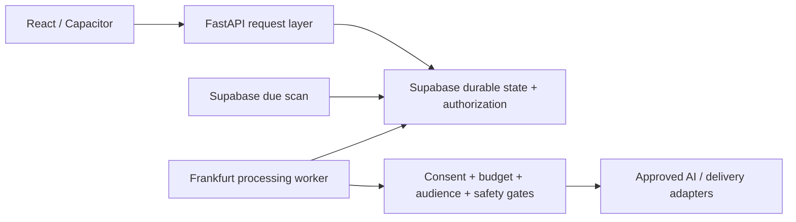

# Phase 0/1 implementation plan

Status: authorized for implementation, 2026-11-14. The user requested this plan and
instructed us to proceed without another permission stop. PLAN.md remains the full
product specification; its safety/privacy rules survive every reuse. This document
is the bounded execution plan and checklist, not a claim that the whole phase exists.

## Outcome

A solo user on web/Android can authenticate, optionally track relationships, receive
a timely AI-drafted check-in, approve/edit/skip/snooze, and see the resulting artifact.
Two accounts cannot access each other's private prompts/context. Membership, sharing,
blocks and revocation are checked server-side. Generation/delivery survive restarts;
no duplicate approval, unapproved provider or unmetered paid call can bypass guards.

## Defaults and authorization

- React/Vite/TypeScript + Capacitor; adapt the sibling's build configuration and
  boundaries rather than copy its fitness domain or its local-only privacy claims.
- Vercel frontend/stateless FastAPI + Frankfurt processing worker; dedicated Frankfurt
  Supabase Auth/Postgres/Storage is the eventual cloud authority.
- Italian, Spanish, Korean, Mandarin, Cantonese, English and German. Mandarin/Simplified
  and Cantonese/Traditional remain separate; locale choice never asserts identity.
- 6-hour cadence, 22:00–08:00 local quiet hours, 3 proactive nudges/local day,
  skip after 30 minutes; accepted per-channel/per-instance overrides remain.
- Recommended owner defaults adopted: label automatic outward content AI-assisted;
  preview and approve every translated outward variant; never rewrite approved text.
- Branding/price deferred. Working app title and nameless bartender only; no personal
  photo. No billing integration, purchasing or new hosting commitment is needed now.
- Mock processors and fictional data first. No external calls merely because keys
  happen to exist in this machine's environment. Actual processor terms, costs,
  credentials and real-data activation must be verified before live use.
- No production deploy or paid provisioning is implied by starting local code.

## Architecture and contracts

First local milestone substitutes an explicitly marked **demo SQLite repository**
for remote Supabase, and a deterministic localized mock composer for external AI.
The local repository is a test adapter, not a new production database decision.
It must demonstrate persistence and compare-and-set decisions but cannot be called
Supabase/RLS or real account security. A local bearer session represents fictional
data only. Demo endpoints must reject non-local use and production configuration.

Production repository operations are explicit contracts: get/update owned prefs,
create/read relationships, propose/approve/redeem invitations, enqueue/claim/finish jobs,
read check-ins, decide with expected version, and read resulting owned/shared entries.
All operations accept a validated actor; do not accept arbitrary client owner IDs.

HTTP initial local contracts:
- GET /api/health: mode/capabilities, no keys or private diagnostics.
- GET /api/demo/session: local-only fictional session, never production authentication.
- GET/PATCH /api/preferences: private locale/timezone/default settings.
- GET/POST /api/relationships: own private records; invitation UI follows later.
- GET /api/checkins; POST /api/checkins: enqueue a mock private reflection.
- POST /api/checkins/{id}/decision: expected version + approve/skip/snooze;
  approval uses explicit reviewed text, skip creates no entry, snooze pauses expiry.
- GET /api/entries: only the fictional actor's resulting private artifacts.

## Execution sequence and completion gates

### M0 — runnable foundation (start immediately)

- [x] Add frontend/backend/shared-catalog layout, pinned lockfiles, local environment
  example, ignored runtime data and clear commands. Preserve existing documents and
  sibling repository; never copy secrets or sibling API URLs.
- [x] Build five-tab responsive shell, accessible controls, light/dark/system themes,
  language switch and seven complete prototype catalogs. Translations are drafts
  until native review; do not call this production localization.
- [x] Adapt sibling Vite proxy/relative build pattern and add a temporary Capacitor
  app ID/configuration. Branding/package identity is explicitly provisional.
- [x] Add FastAPI health, local demo session, durable demo repository and mock worker.
- [x] Provide one local check-in flow: enqueue -> worker -> pending -> edit/approve,
  skip or snooze -> correct private artifact/state. Show honest demo/zero-cost labels.

### M1 — local contract/reliability proof

- [x] Test local repository cross-owner denial and local-demo API session/host/origin guards.
  This is not a multi-user Supabase/OAuth/RLS proof.
- [x] Test atomic competing decisions, restart persistence, job claim/idempotency,
  lease recovery, skip-without-artifact and snooze/deadline behavior.
- [x] Test local scheduling pause/disable, quiet-hour/DST/local-day caps and fair
  cadence with no cross-scope burst. Postgres dispatcher parity remains M3 work.
- [x] Verify catalog key parity, locale fallback and consistent Mandarin/Cantonese labels.
- [x] Run build plus functional browser smoke at mobile/desktop widths; no console
  errors; verify keyboard controls and switching all seven locales.

### M2 — Supabase/auth foundation

- [x] Review current Supabase documentation and CLI before schema work; create versioned
  migrations locally using its migration tooling. Keep deployment separate.
- [x] Deploy private profile/relationship-label/check-in/entry tables in the dedicated
  Frankfurt project with RLS, explicit verified-email beta admission and atomic
  versioned check-in RPCs. Transactional multi-actor SQL tests pass. This is a private
  foundation, not the full shared relationship schema.
- [x] Verify the admitted tester's live web Google/PKCE sign-in, recovery/password
  update, email/password login and private reflection save/reload. User confirmed the
  reflection in an independent browser/device and after email/password sign-in.
  Fresh signup/confirmation for other accounts and native callbacks are not certified.
- [x] Current memberships/generations, own aliases/archive/mute, immediate leave,
  pairwise blocks and versioned unanimous invitations/approval/explicit redemption.
  Private tables and current-member metadata RLS; no authorization from user metadata.
- [ ] Explicit item-recipient grants, received-version history and sharing/revocation
  across content, Storage, AI context, search and exports.
- [ ] Email/password, verified email, recovery and Google sign-in, explicit invite join,
  session revocation and reauthentication. Validate exact MFA/account-linking behavior.
- [x] Isolated real PostgreSQL tests with multiple concurrent actors and A/B/C gates,
  plus the three-browser membership workflow backed by real SQL/RLS. Hosted smoke
  rolled back all synthetic records. Live multi-person OAuth/native delivery is separate.
- [ ] Support verified project/keys through secure configuration. No production keys
  in source, frontend secrets, tests, docs or logs. Missing config fails closed.

### M3 — production durable check-in loop

- [ ] Supabase jobs/check-ins/entries/decisions with claims, leases and deadline indexes.
- [ ] Transactional due-scan creates one job per actor/scope/due-slot; worker owns
  execution. No API-process background task is the durable source of truth.
- [ ] Recheck source consent, item grants, blocks, archive/leave, pause and expiry before
  each attempt. One winning decision; distinct skipped/cancelled/failed/uncertain.
- [ ] Enforce source/recipient/version-bound approval of outward drafts/translations.
- [ ] Pause/snooze without stale sends; no morning catch-up flood. Fair scheduling across
  0..N relationships; synthetic timers/tests, not real-user messaging to test races.

### M4 — approved providers and cost controls

- [ ] Provider-neutral compose interface plus deterministic outage/budget/consent paths.
- [ ] Implement DeepSeek/Anthropic adapters only after current model pricing/terms and
  seven-language/tool/safety evaluations; caller selects only approved capability routes.
- [ ] Persist per-user processor/saved-context consent; no retrieval from unchecked
  journals/documents/prior chats; explicit attachments are task-scoped.
- [ ] Usage ledger, conservative atomic reservations, pending unknown charges,
  reconciliation and EUR 20 aggregate test target. Safety calls/retries/fallback count.
- [ ] Centralized inclusive system core, source minimization and injection resistance.
  Distinguish an outage from no consent or exhausted budget in static copy.
- [ ] Live calls limited to explicit smoke tests after verified prerequisites.

### M5 — Android and in-app delivery

- [ ] Generate a clean Android wrapper from the working Capacitor config; do not copy
  SchedaPRO application identity/signing. Validate required Java/SDK tooling.
- [ ] In-app inbox remains canonical. Native push permissions requested just in time;
  denial retains full in-app use. Register tokens per actor/device, remove on revocation.
- [ ] Discreet previews, receipt/uncertainty semantics and no unapproved channel fallback.
- [ ] Pending-send list, edit/cancel, independent action safety gate and private result.
- [ ] Real Android test: background/foreground, network loss, reconnect and navigation;
  distinguish successful cap sync, APK build, device execution and push delivery.

### M6 — beta readiness, only after the slice works

- [ ] Evaluate the deployment quote against the separate hosting/storage budget;
  configure Vercel + Frankfurt worker + dedicated Supabase when available/approved.
- [ ] Confirm backups include separately handled file objects and run restore/delete
  drills with tombstone replay, not resurrected jobs/consents.
- [ ] Seven-language critical/safety copy reviewed; verified country resource entries
  or honest unknown-region behavior. Support address and reviewer ownership exist.
- [ ] Optional analytics consent/metadata pipeline only; no replay or private content.
- [ ] Auth/access/safety/budget tests plus real web/Android evidence, no automatic external
  production message sent during testing. Testers admitted explicitly.

## Phase exclusions

No full bartender chat/tools, OCR/uploads/Drive/voice, rich goals/plans, gallery,
paid checkout, SMS/WhatsApp/Telegram/Google Calendar, iOS delivery or growth scoring
in M0/M1. Their accepted designs stay in PLAN.md. Navigation labels can identify
upcoming areas but must not masquerade as functioning controls.

## Validation and rollback

Prefer behavioral tests for state races, ownership and consent to snapshots of source
code. Use temporary demo databases in tests; never touch personal or sibling data.
Every milestone records tests run and remaining limits in CURRENT-TASK.md. Keep
migrations additive/reversible where possible; a rollback cannot undo a sent external
message. Do not enable live data to make an incomplete demo appear production-ready.

## References checked

Vite: https://vite.dev/guide/
Capacitor: https://capacitorjs.com/docs/getting-started
FastAPI tests: https://fastapi.tiangolo.com/tutorial/testing/
React localization: https://react.i18next.com/latest/using-with-hooks

## Verified first-slice progress

M0/M1 are complete as a **local fictional-data demo** with tested scheduling rules.
The hosted preview uses browser-local fictional data; a dedicated Frankfurt Supabase
project now holds the private-sync foundation. Git pushes to main deploy to Vercel.
M2 is partial: core web auth/private reflection sync and membership/invitation/block
foundations passed their respective tests. Broader signup/delivery, session/MFA
management and explicit content-sharing grants remain open; native auth remains M5.
The scheduling dispatcher still needs a Postgres/hosted-worker port in M3. See
CURRENT-TASK.md for evidence and CLOUD-AUTH-SETUP.md for the auth activation boundary.
The local FastAPI adapter remains development-only and fails closed in production.
